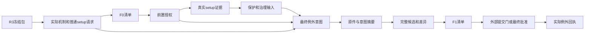

# Fast39授权草案R3技术复审与P0.1出口

2026-11-05，Asia/Shanghai；Codex单代理作者技术复审，非独立接受。复审对象为`FAST39-C4-EX-AUTH-DRAFT-R3`，FREEZE SHA256为`e67f4b318209d23af0eab22f46b8c0d9b6c6d8fc744cfad218af4b695e3ea1a4`。执行范围是[进展计划R2的P0.1](../../plans/2026-11-05-project-progress-and-next-steps-r2.md)，没有执行P0.2及后续动作。

**结论：R2-TR01和R2-TR02均在R3合同层面闭合，本轮未发现新的阻断性文档问题。P0.1按技术复审文档出口完成；实际机制、阶段原件、授权、源治理和恢复仍未具备，不能进入源写入或业务生产。** 不要求为本轮已闭合问题自动另写R4，不原地修改R1—R3或旧评审结论。

## 1. 两项问题的逐项结论

| 问题 | R3结论 | 依据／保证范围 |
|---|---|---|
| R2-TR01 请求原件hash与事务意图摘要混淆 | CLOSED_AT_CONTRACT_LEVEL | 请求原件按完整原字节计算；B意图按冻结Schema的完整解析对象规范序列化，排除集合为空、基线也纳入。原件与意图摘要分别存外部F1／门／回执，B摘要进入事务request_sha256。普通事务排除两项expected的算法不改；B差异明确属于待批准例外 |
| R2-TR01 算法／证明对象不精确 | CLOSED_AT_CONTRACT_LEVEL | UTF-8严格、无BOM、重复键／浮点／非有限数／孤立代理码拒绝；对象键排序、数组顺序保留、无Unicode或换行规范化、规范字节无末尾换行。Schema之外还须核引用原件、真实授权／producer／基线、两摘要和实际机制，不拿Schema0冒充执行 |
| R2-TR02 同一最终请求先于未知post-start基线冻结 | CLOSED_AT_CONTRACT_LEVEL | F0冻结真实机制／模板和完整普通setup请求；普通setup成功后才以其真实后版本形成F1最终例外请求、候选及差异。F0不再要求未知最终请求，F0和F1不是同一原件改名或换expected |
| R2-TR02 阶段授权／占用不区分 | CLOSED_AT_CONTRACT_LEVEL | B_SETUP只允许自身空grants的普通started；条件授权须准确覆盖固定F0／机制／实例化规则，或F1后另取最终批准。提交门独立在F1之后；源README及自身post-setup行本应存在，外来／不明占用、链接、错hash或已用新事务ID才阻新动作 |

原问题P2仍以R2时点原字节保留；本表是对准确R3的新结论，不重签旧证据。条款依据见[R3摘要／冻结合同](../../business-baseline/fast39-static-authorization-draft-r3/摘要与两阶段冻结合同.md)§1—5、`hash-and-freeze-contract.json`、`exception-intent.schema.json`及B主稿／机器稿。机器结论见[review-findings.json](review-findings.json)。

## 2. 摘要及原工具的相容边界

本轮在既有Python3.12.14／jsonschema4.26.0环境完成[59项定向只读／内存检查](offline-review-checks.json)。相较上一轮65项文稿自核，本轮重点核复审边界，没有重新执行产品、writer或全部历史广验：

- 相同意图的缩进／紧凑排版、末尾空白、物理CRLF及Unicode转义可改变raw hash而不改变意图摘要；已冻结原件的raw guard仍必须失败，不能因意图等价重写原件。不同Unicode规范形式的数据保持不同意图摘要。
- 例外基线revision／整册hash、授权输入、脚本和保护清单均进入完整意图摘要；普通事务的expected两字段仍由原wrapper排除。原`canonical(I)`可复用为规范序列化能力，**不能将B意图当普通apply请求执行**：它的kind等顶层字段不符合原普通请求形状。
- 自身hash、候选完整after hash、后置提交门等额外字段被最终请求Schema拒绝；重复键、BOM、浮点、NaN、孤立代理码、未填null、错误操作或setup／baseline矛盾均被相应层拒绝。
- 内存中将现有登记记录的摘要值替为合成完整意图摘要，原六字段登记校验可以容纳；这只证明格式相容，不能证明真实producer、外部引用或授权。实际源事件未改。原工具的这一覆盖限制在R3已有明确说明，不是新的源工具缺陷。

两类摘要的数值不必永远不同：若原件恰等于规范字节，raw值可能等于意图值；合同区分的是计算对象和各自冻结校验职责。本轮没有把“两个值必须不相等”作为执行条件，也没有因相等取消任一证据。

## 3. F0／F1与证据无环依赖

R3依赖可按以下顺序构造；节点表示合同中的未来证据类别，**不是本轮已形成的真实F0／F1**：

本轮图检查确认该顺序无环，并确认五类反向依赖会成环：F0包含后来的前置授权hash；请求包含自己的摘要；请求包含完整候选after hash；请求包含后置门hash；请求包含未来回执hash。R3已明确禁止这些反向hash依赖。预定路径／ID可以提前固定，不等于提前填写未来hash或成功事实。

条件授权和setup-only两分支的有限合成真值表均符合R3：没有B_SETUP、setup未知、F1未冻结、条件未明确、需要最终批准而尚未取得、基线漂移或治理失败时，都不能提交。真实已有授权可以按准确条件沿用，不强迫每阶段重复批准；技术检查通过本身也不产生授权。

F1候选及等待批准在源锁外；实际提交时持原锁重读、复算并用冻结参数在内存重现候选，完整字节／hash必须与F1一致，再一次fsync／原子替换／读回。不嵌套普通apply，不修改F1重基，不在锁内等人工决定。候选准备时间与实际写入／读回时间分别如实记录，写前verification不预填写后通过。源普通事务生命周期和例外回执的产生机制也分别保留。

这些条款已具备一致的合同解释；真正的脚本重现、锁／中断／原子替换行为，以及每份实际引用原件是否无反向依赖，仍须在P0.2及后续准确阶段逐件验证。本轮合成图和真值表不代替它们。

## 4. 授权和各阶段尚缺的对象

以下按各自时点满足：机制准备范围、B_SETUP前置及B_COMMIT门分别核对；源恢复后验、A候选和实际交付是后续待产出口，不倒作普通setup之前须已有的事实。

| 缺件 | 解除条件与阻止动作 |
|---|---|
| 实际机制准备范围 | 取得准确的P0.2准备／隔离核验范围后，才形成固定任务私有脚本、模板、有界实例化规则和真实机制负例。当前只获P0.1复审，不据本结论实施机制 |
| B实际F0和B_SETUP | 正常CI动作后冻结当时机制／模板／原工具、完整普通setup请求、pre-setup源基线和模式；前置授权准确绑定F0，明确是否包含条件B_COMMIT。未具备前不得普通started |
| 正常周报和治理0 | 源CI有权任务按原流程实质复盘，报告／哨兵／hash与实际时间相符，再取新鲜完整治理0；不刷新日期冒充、不豁免时效，不要求63模式一律关闭 |
| 真实setup及F1原件 | 仅确认自身setup的准确前后字节／请求／返回／事件、owner／空grants后，绑定真实post-start基线、引用原件及两摘要、完整私有候选／差异／保护证据。idempotent或当前整册hash单独不够 |
| 外部提交门及B_COMMIT | 真实门绑定准确F1和全部实际输入；证明已有明确条件覆盖，或取得准确最终批准。入锁再次核原字节和复现；F1漂移停止，失败／未知不自动重试或回滚覆盖 |
| 实际恢复及源后验 | 获准后才执行单次恢复；另取严格选行、两处准确差异、旧六单元／旧事件／14业务行／归属保全及真实事务／完整治理0证据，再按实情普通记录进展／结束 |
| A静态候选及后续交付 | B通过不暗授A。Batch局部例外／限定profile、准确四字段／所属事务仍须明确批准；后续DSL／节点／后台／DSH／交付指纹／归属及真实运行、专业／用户、G0和发布按各阶段原门另证 |

上述均为R3和原计划已有的阶段性条件，不是本轮新增全局前置。C4／LA已经确认的限定设计采用不重开，也不要求全部29项、全部规则正式生效或真实付费运行先完成才准备对应有界静态材料；同一候选自己的后续运行／专业／业务Batch出口不倒作其静态准备前置。原来已经要求的前批出口或准确有界例外、源治理及动作授权仍须满足，未来源恢复和A制作不能借本技术复审越过。

机器缺件见[remaining-gates.json](remaining-gates.json)。未来机制／证据路径继续沿R3的R2后缀身份，当前均未创建；本轮没有提前生成F0、setup请求、F1请求／候选或实际writer。

## 5. 本轮源观察和保全

源README仍revision489，完整SHA256为`0fa3199aceafb6042e7f573a8dbaef521386fa9f2e9fc8f8684695c141f7ce52`。严格原工具选择仍返回`malformed table separator`，两处结构未恢复；本文没有把合同闭合写成源定位已通过。

本轮新鲜[源治理CLI回执](governance-rerun.json)仍exit1，唯一CLI错误为周报超过7天，`ARCHIVE_SCAN=not_scanned`、`registered_external / identity_only`。本轮只读检查，没有执行写CI的正常复盘；周报通过和严格业务行验证未来须分别取得，任一不替代另一项。

[preflight.json](preflight.json)按根R1／EXEC-R2绑定当前整体／项目计划、P0.1、相关合同／源规范及原始完整字节hash。当前仍协同1.2.2、规划1.3.1／NS1-R1＋适用P28／P30＋BM1-R1／S1／S2-R1；上轮273输入未变，新增本次活动计划及两件配套对象，共276项输入。适用正文定向读取，其他历史输入只核身份，不冒称全部内容复审或重跑245／153项广验。

R1—R3、原规划及历史证据保持。本轮只新建P0.1复审和私有检查证据，不修合同、不另版R4、不更改计划旧勾选或当前状态入口；未改业务代码／源登记册／CI，未加源锁或调用apply、未部署、未新增模型／API／上传／生成／付费，未提交推送。最终原件与身份保全见[verification.json](verification.json)。
