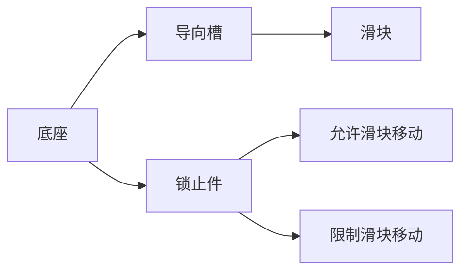

# 技术交底书：滑移组件

**专利类型**：发明

本件为公开合成测试交底，由同目录外的原始滑移组件技术交底整理。发明人和申请人信息空缺。

## 一、技术领域

手动工装中的滑移与位置保持。

## 二、待解决问题

装夹前希望沿给定方向调整滑块。装夹后希望限制滑块继续移动。尚无测试数据。

## 三、技术方案

底座设沿第一方向延伸的导向槽，滑块与导向槽配合。锁止件设置于底座，具有允许和限制滑块移动两种状态。锁止件的形状、驱动方式和与滑块的具体连接方式未给出。

## 四、效果和待确认事项

定性目标为便于调整和保持位置。保持力、切换方式、尺寸、材料及实测表现待确认。
